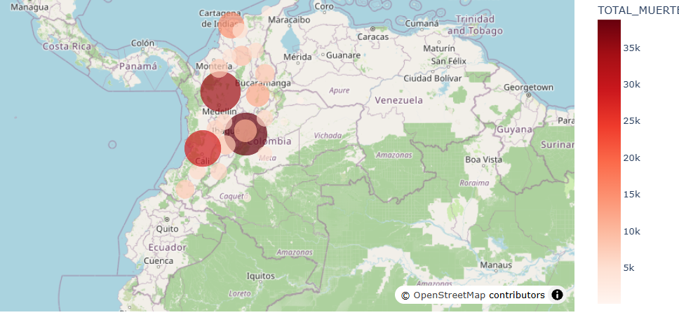
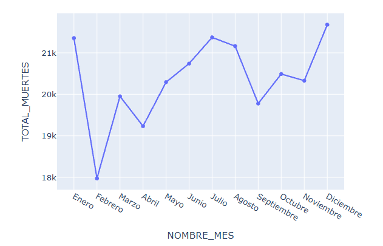
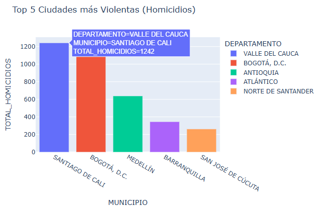
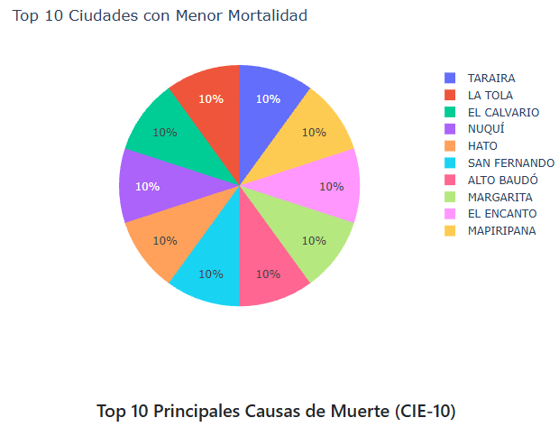
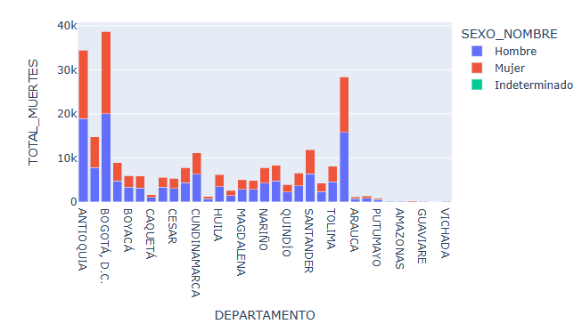
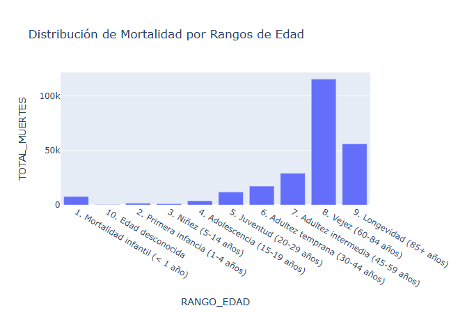

# Análisis de Datos Estadísticos Vitales Colombia (2019) - Aplicación Web Analítica e Interactiva con Dash y Plotly

Este repositorio contiene la arquitectura, el código fuente y los conjuntos de datos preprocesados de la aplicación web interactiva desarrollada para el análisis de las estadísticas de muerte en Colombia durante el año 2019. 

El proyecto se desarrolló en el marco de la asignatura **Aplicaciones I** de la **Maestría en Inteligencia Artificial** de la **Universidad de La Salle**.

---
## 1. Introducción del Proyecto

Esta aplicación web dinámica transforma los datos en un tablero de control (*dashboard*) desplegado en la nube. Utilizando el entorno de programación Python junto con las librerías **Dash**, **Plotly Express** y **Dash Bootstrap Components**, la plataforma permite explorar patrones geográficos, tendencias temporales, causas diagnósticas principales, comparaciones de género y distribuciones etarias en la población colombiana.

---

## 2. Objetivo

Desarrollar y desplegar una aplicación web dinámica e interactiva en Python mediante **Dash** y **Plotly**, publicada en la plataforma PaaS **Render**, que facilite la visualización exploratoria y la interpretación fundamentada de los patrones demográficos, geográficos y causales en Colombia para el año 2019.

---

## 3. Estructura del Proyecto

El repositorio está organizado bajo un esquema modular que separa el procesamiento de datos, el código fuente de la interfaz gráfica y los archivos de configuración para el despliegue en la nube:

mortalidad-colombia-2019/
├── data/                               # Archivos CSV livianos preprocesados
│   ├── muertes_departamento.csv        # Agregación para mapa por dep (G1)
│   ├── muertes_mes.csv                 # Tendencia mensual de registros (G2)
│   ├── top5_municipios.csv             # Registros por municipio X95 (G3)
│   ├── top10_menor_mortalidad.csv      # Municipios con menor índice (G4)
│   ├── top10_causas.csv                # Ranking CIE-10 de causas (G5)
│   ├── muertes_sexo_depto.csv          # Comparación por género y dep (G6)
│   └── muertes_edad.csv                # Categorización por edad DANE (G7)
├── src/                                # Código fuente de la aplicación
│   └── app.py                          # Cod principal de Dash y maquetado
├── preprocesar_datos.py                # Script local para limpieza de datos
├── requirements.txt                    # Dependencias de Python
├── render.yaml                         # Configuración para Render PaaS
└── redme.md                           # Documentación Actividad 4.
---

## 4. Requisitos

### Tecnologías Empleadas y Software

| Herramienta                   | Versión / Tipo       | Función en el Proyecto                                  |
| ----------------------------- | -------------------- | ------------------------------------------------------- |
| **Python**                    | 3.14.                | Lenguaje de programación principal                      |
| **Dash**                      | 2.14.0+              | Framework web reactivo para dashboards analíticos       |
| **Plotly Express**            | 5.18.0+              | Generación de gráficos vectoriales e interactivos       |
| **Pandas**                    | 2.1.0+               | Lectura, filtrado y agregación estructurada de datos    |
| **Gunicorn**                  | 21.2.0+              | Servidor HTTP WSGI para entorno de producción en Render |
| **Dash Bootstrap Components** | 1.5.0+               | Diseño responsivo basado en rejillas Bootstrap          |
| **Git / GitHub**              | Control de versiones | Repositorio público y CI/CD hacia Render                |
| **Render**                    | PaaS (Cloud)         | Hosting y despliegue del servicio web                   |

### Archivo `requirements.txt`

El archivo `requirements.txt` ubicado en la raíz del repositorio especifica las dependencias exactas que Render instala automáticamente durante la etapa de compilación:

```
dash==4.5.0
plotly==7.1.0
pandas==3.1.0
gunicorn==26.2.0
dash-bootstrap-components==2.0.4
openpyxl==3.1.5

```

---

## 5. Despliegue en la Nube (Render PaaS)

La aplicación ha sido publicada en la nube mediante **Render**, aprovechando su integración continua con GitHub:

1. **Exposición del servidor WSGI en `src/app.py`**: Se agregó la línea `server = app.server` inmediatamente después de inicializar la instancia `app = Dash()`.
2. **Creación del repositorio en GitHub**: Se subió la carpeta Actividad 4 con todos los archivos exeptuendo los .xlsx principales de la data.
3. **Conexión en Render**:  
  * Se ingresó al panel de Render y se seleccionó **New + → Web Service**.
  * Se vinculó el repositorio público de GitHub.
4. **Configuración de parámetros en Render**:  
  * **Name**: `Actividad-4-Jorge-Baquero`
  * **Environment**: `Python 3`
  * **Build Command**: `pip install -r requirements.txt`
  * **Start Command**: `gunicorn src.app:server`
  * **Instance Type**: `Free` (512 MB RAM)
5. **Verificación**: Render compila las dependencias en aproximadamente 3 a 5 minutos y asigna una URL pública permanente.

---

## 6. Instalación

Sigue estos pasos en tu computadora local para clonar el repositorio, configurar el entorno virtual y ejecutar la aplicación en un servidor local:

### Paso 1: Clonar el repositorio desde GitHub

Abre la terminal de tu sistema operativo o Visual Studio Code y ejecuta:

```
git clone https://github.com/jorgebaquero-pixel/Actividad-4-Jorge-Baquero.git
cd Actividad-4-Jorge-Baquero

```

### Paso 2: Crear y activar un entorno virtual

Para aislar las dependencias del proyecto:

* **En Windows:**  
```  
python -m venv venv  
.\venv\Scripts\activate  
```
* **En macOS / Linux:**  
```  
python3 -m venv venv  
source venv/bin/activate  
```

### Paso 3: Instalar las dependencias

```
pip install -r requirements.txt

```

### Paso 4: Ejecutar el preprocesamiento de datos

```
python preprocesar.py

```

### Paso 5: Ejecutar la aplicación web localmente

```
python src/app.py


```

## 7. Visualizaciones Interactivas y Explicación de Resultados

La interfaz gráfica integra 7 componentes visuales interactivos organizados en filas responsivas. A continuación se describe el propósito, la configuración y los hallazgos analíticos clave de cada elemento:

### Visualización 1: Mapa Coroplético de Distribución Territorial

* **Tipo de gráfico**: Mapa coroplético por departamento.
* **Propósito**: Evaluar el volumen total de registros concentrados en cada entidad territorial de Colombia durante 2019.
* **Hallazgos clave**: Los departamentos con mayor concentración de registros coinciden con los principales centros urbanos e industriales del país: Bogotá D.C., Antioquia y Valle del Cauca lideran las cifras absolutas debido a la alta densidad demográfica. Por el contrario, los departamentos de la Orinoquía y Amazonía presentan los registros más bajos en valores absolutos.



---

### Visualización 2: Gráfico de Líneas de Evolución Mensual

* **Tipo de gráfico**: Gráfico de líneas con marcadores temporales (`px.line`).
* **Propósito**: Identificar variaciones estacionales o picos atípicos a lo largo de los 12 meses de 2019.
* **Hallazgos clave**: La curva muestra un comportamiento relativamente estable con promedios mensuales que oscilan cerca de la media nacional, observándose un ligero incremento hacia el cierre del último trimestre del año (noviembre y diciembre), fenómeno asociado a factores de movilidad y festividades de fin de año.



---

### Visualización 3: Gráfico de Barras por Municipio (Top 5)

* **Tipo de gráfico**: Gráfico de barras horizontales/verticales (`px.bar`).
* **Propósito**: Analizar las 5 ciudades colombianas con mayores índices registrados bajo el código CIE-10 X95.
* **Hallazgos clave**: Los municipios principales (Cali, Medellín, Bogotá, Barranquilla y Cúcuta) concentran la mayor cantidad de registros, reflejando dinámicas urbanas y concentración poblacional.



---

### Visualización 4: Gráfico Circular de Menor Índice de Registro (Top 10)

* **Tipo de gráfico**: Diagrama de sectores / torta (`px.pie`).
* **Propósito**: Identificar los 10 municipios colombianos con menor volumen absoluto de registros.
* **Hallazgos clave**: Municipios de menor escala poblacional y áreas rurales dispersas registran cifras mínimas anuales, reflejando una dinámica demográfica de baja escala.


---

### Visualización 5: Tabla Interactiva de Principales Causas

* **Tipo de componente**: Tabla de datos filtrable (`dash_table.DataTable`).
* **Propósito**: Enumerar en orden descendente las 10 causas diagnósticas principales en Colombia, vinculando el código CIE-10 de 4 caracteres con su descripción textual oficial.
* **Hallazgos clave**: Las enfermedades crónicas no transmisibles encabezan el ranking epidemiológico en Colombia: el infarto agudo del miocardio (I219), las enfermedades pulmonares obstructivas crónicas (J449) y las complicaciones de la diabetes mellitus (E147) representan las principales causas en el país.


---

### Visualización 6: Gráfico de Barras Apiladas por Sexo y Departamento

* **Tipo de gráfico**: Barras apiladas multidimensionales (`px.bar` con `barmode='stack'`).
* **Propósito**: Comparar la proporción y distribución de registros entre hombres y mujeres para cada departamento.
* **Hallazgos clave**: Existe una brecha diferenciada entre géneros en los departamentos de Colombia, observándose diferencias en la distribución demográfica según la variable sexo.



---

### Visualización 7: Histograma de Distribución por Grupos de Edad

* **Tipo de gráfico**: Histograma de distribución agrupada (`px.bar`).
* **Propósito**: Representar la frecuencia categorizada por los rangos estandarizados del DANE en la variable `GRUPO_EDAD1`.
* **Hallazgos clave**: La distribución por edad presenta una bimodalidad característica: una vulnerabilidad inicial en la etapa infantil (menores de 1 año) y una concentración masiva en las etapas de vejez (60-84 años) y longevidad (85 años y más), reflejando la transición demográfica hacia el envejecimiento poblacional.



---

## 8. Ficha Técnica y Créditos del Proyecto

* **Asignatura**: Aplicaciones I
* **Programa**: Maestría en Inteligencia Artificial
* **Institución**: Universidad de La Salle (Bogotá, Colombia)
* **Docente**: Cristian Duney Bermúdez Quintero
* **Integrantes del Grupo**:  
  * Jorge Luis Baquero Guio
  * [Nombre Completo Integrante 2]
  * [Nombre Completo Integrante 3]
  * [Nombre Completo Integrante 4]
* **Enlace a la Aplicación Desplegada (Render PaaS)**: [Incluir aquí el enlace al servicio desplegado en Render]
* **Enlace al Repositorio de GitHub**: [Incluir aquí el enlace al repositorio público en GitHub]